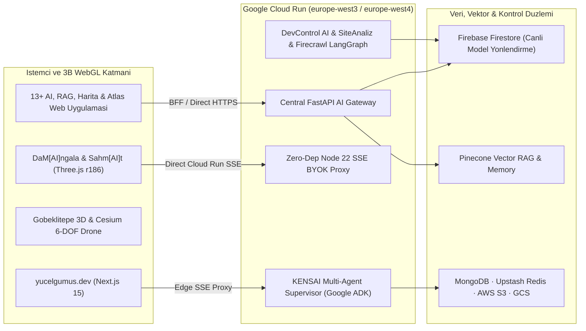

  <picture>
    <source media="(prefers-color-scheme: dark)" srcset="./assets/hero-dark.svg" />
    <source media="(prefers-color-scheme: light)" srcset="./assets/hero-light.svg" />
    
  </picture>

    

  
  
  
  

---

## 👨‍💻 Mühendislik Odağı & Deneyim

Merhaba, ben **Yücel Gümüş**. **Çoklu etmenli yapay zeka (Multi-Agent AI) sistemleri**, **gerçek zamanlı 3B WebGL / dijital ikiz sahneleri** ve **mekansal zeka (CBS / GIS)** alanlarında fikirden canlı üretime uzanan yazılımlar tasarlıyorum.

- 🧠 **Full Stack AI Engineer @ EnerwiseAI (Tekhnelogos):** Çoklu etmenli iş akışı orkestrasyonu, yerel donanım (**NVIDIA DGX Spark**) üzerinde LLM dağıtımı/ince ayarı, zaman serisi modellemesi, OCR + yapılandırılmış veri çıkarımı ve `.NET Core` / `React & TypeScript` üretim sistemleri geliştiriyorum.
- 🏗️ **Geçmiş Üretim Deneyimi:** **Turkuvaz Medya Grubu**'nda yüksek trafikli dijital yayın ve akademi platformları; **Pavo Group (Interdata)** bünyesinde gerçek zamanlı araç/sensör telemetri sistemleri ve test otomasyonu; **Harita Genel Müdürlüğü**'nde **CesiumJS** tabanlı 3B uydu/İHA harita uygulamaları geliştirdim.
- ☁️ **Canlı Ekosistem:** **Google Cloud Run**, **Firebase Hosting / Firestore**, **Vercel Edge** ve **GitHub Pages** üzerinde aktif çalışan **20+ canlı uygulama**, merkezi FastAPI AI ağ geçidi ve çok sağlayıcılı akış proxy'leri işletiyorum.

---

## 🏗️ Canlı Üretim Mimarisi

---

## 🌟 Vitrin Projeleri (Seçkin Sistemler)

| Proje | Mühendislik Özeti | Teknoloji | Erişim |
|---|---|---|---|
| **DaM\[AI\]ngala** | %100 prosedürel 3B çayevinde Türk Daması ve TAZOF Mangala arenası; sıfır bağımlılıklı Node 22 SSE proxy ile OpenAI, Claude, Gemini ve OpenCode Zen arasında canlı maçlar | `React 19`, `Three.js`, `Node 22`, `Cloud Run` | [Canlı](https://damaingala.web.app/) |
| **Şahm\[AI\]t Arena** | Obsidyen katedral sahnesinde meshopt `.glb.gz` ve dinamik LOD taşlar, düello animasyonları ve 4 LLM sağlayıcılı canlı BYOK satranç karşılaşmaları | `React 19`, `Three.js`, `chess.js`, `Node 22` | [Canlı](https://sahmait.web.app/) |
| **DevControl AI** | GitHub repo sağlığı, hotspot refactor tespiti, commit sınıflandırma ve Gemini tabanlı mimari kod inceleme/risk analizi platformu | `TypeScript`, `React 19`, `Express`, `Firestore` | [Canlı](https://devcontrol-ai.web.app/) · [GitHub](https://github.com/yucel-gumus/DevControl-AI) |
| **Cesium 6-DOF Drone** | Uzungöl arazisinde 240 Hz RK4 kuadrotor fiziği, 120 Hz 17-durumlu ESKF, Dryden rüzgâr türbülansı, 1.150 OSM engeli ve PX4 `.ulg` kalibrasyonu | `CesiumJS`, `Web Workers`, `ES Modules`, `Playwright` | [Canlı](https://yucel-gumus.github.io/cesium-drone.github.io/) · [GitHub](https://github.com/yucel-gumus/cesium-drone.github.io) |
| **SiteAnaliz** | Lighthouse, CrUX, HTTP Observatory, SSL Labs ve W3C HTML denetimlerini SSRF korumalı tarayıcıyla birleştirip düzeltme prompt'ları üreten denetim motoru | `Node.js`, `Express`, `Gemini`, `Cloud Run` | [Canlı](https://site-analiz.web.app/) · [GitHub](https://github.com/yucel-gumus/web-site-analiz) |
| **Göbeklitepe 3B İkiz** | A–H anıtsal yapıları, 118 arkeolojik buluntu, 12 rehberli keşif durağı ve gündönümü güneş hizalanması simülasyonu sunan 3B dijital ikiz | `Three.js`, `JavaScript`, `WebAudio`, `Cloud Run` | [Canlı](https://gobeklitepe.web.app/) |
| **Türk Tarih Atlası** | MÖ 220'den günümüze 87 devlet, 748 hükümdar, 798 savaş ve 834 birincil kaynağı derleme zamanı Zod doğrulamasıyla sunan etkileşimli soyağacı | `Svelte 5`, `TypeScript`, `Vite 8`, `Zod` | [Canlı](https://yucel-gumus.github.io/turk-tarih-atlasi/) · [GitHub](https://github.com/yucel-gumus/turk-tarih-atlasi) |
| **Portfolyo & KENSAI** | Google ADK supervisor + GitHub ve CV uzman ajanlarıyla canlı SSE sohbet, Upstash Redis önbelleği ve S3 medya yönetimi sunan ana platform | `Next.js 15`, `Google ADK`, `FastAPI`, `MongoDB` | [yucelgumus.dev](https://www.yucelgumus.dev/) |

---

## 📂 Tüm Proje Ekosistemi

<strong>🤖 Yapay Zeka, Çoklu Ajan, RAG &amp; Üretken Uygulamalar (8 Açık Proje)</strong>

| Proje | Açıklama | Teknoloji | Bağlantılar |
|---|---|---|---|
| **Market AI** | Canlı market fiyat arama, 3 aşamalı AI tarif → ürün seçimi ve tek/çift mağaza rota optimizasyonu | `Next.js 15`, `Zustand`, `Leaflet`, `Vitest` | [Canlı](https://market-ai-coral.vercel.app/) · [GitHub](https://github.com/yucel-gumus/market-ai) |
| **Yapay Zeka Tartışma Platformu** | Çok turlu uzman ajan münazarası, tarafsız Hakem Ajan puanlaması ve kalıcı paylaşım | `Next.js 15`, `React 19`, `Firestore` | [Canlı](https://yapay-zeka-tartisma-platformu.vercel.app/) · [GitHub](https://github.com/yucel-gumus/yapay-zeka-tartisma-platformu) |
| **RAG Web Chat** | Web sitelerini SSRF korumalı kazıyıp oturum bazlı kaynaklı soru-cevap yapan RAG platformu | `Next.js 15`, `Cheerio`, `Pinecone` | [Canlı](https://rag-web-chat.vercel.app/) · [GitHub](https://github.com/yucel-gumus/RAG_Web_Chat) |
| **Document Chat** | PDF, DOCX ve TXT belgelerini parçalayıp SSE akışıyla doküman sohbeti sunan RAG arayüzü | `Next.js 15`, `pdfreader`, `mammoth` | [Canlı](https://document-chat-iota.vercel.app/) · [GitHub](https://github.com/yucel-gumus/document_chat) |
| **Firecrawl + LangGraph Summarizer** | LangGraph durum makinesi ile canlı web sayfalarını yapılandırılmış JSON özete dönüştüren servis | `FastAPI`, `LangGraph`, `Firecrawl`, `Gemini` | [Canlı](https://firecrawl-mcp.web.app/) · [GitHub](https://github.com/yucel-gumus/Firecrawl_MCP-Gemini-LangGraph) |
| **GA4 MCP Chat** | Google Analytics 4 verilerini Model Context Protocol üzerinden doğal dilde sorgulayan analitik paneli | `React`, `TypeScript`, `MCP`, `GA4` | [Canlı](https://ga4-mcp-chat-kappa.vercel.app/) · [GitHub](https://github.com/yucel-gumus/GA4_MCP_Chat) |
| **AI Flashcard Generator** | Konu başlığından çift taraflı etkileşimli çalışma kartları ve PDF çıktısı üreten uygulama | `React 19`, `Vite 6`, `jsPDF` | [Canlı](https://bilgi-kart-olu-turucu.vercel.app/) · [GitHub](https://github.com/yucel-gumus/flashcard_generate) |
| **AI Speech-to-Text** | WebAudio frekans spektrumu ile ses kaydı, transkripsiyon ve metin iyileştirme | `TypeScript`, `Vite 6`, `WebAudio`, `DOMPurify` | [Canlı](https://yucel-gumus.github.io/speech-to-text/) · [GitHub](https://github.com/yucel-gumus/speech-to-text) |

<strong>🗺️ Mekansal Zeka (CBS / GIS), Harita &amp; Görsel Analiz (7 Proje)</strong>

| Proje | Açıklama | Teknoloji | Bağlantılar |
|---|---|---|---|
| **Mosque AI (İstanbul Cami Rehberi)** | 2.741 İstanbul camisi GeoJSON verisi, namaz vakitleri ve tool-calling harita asistanı | `React 19`, `Google Maps`, `Zustand`, `Vitest` | [Canlı](https://yucel-gumus.github.io/mosque_ai/) · [GitHub](https://github.com/yucel-gumus/mosque_ai) |
| **AI Map Route Planner** | Çok günlük gezi rotası, TSP kümeleme, Street View ve yazdırılabilir broşür planlayıcısı | `Vanilla TS`, `Vite 6`, `Google Maps SDK` | [Canlı](https://ai-map-planning-and-info.vercel.app/) · [GitHub](https://github.com/yucel-gumus/ai_map_planning_and_info) |
| **3D Image Space** | 3B küre ve UMAP yerleşimi üzerinde anlamsal görsel arama ve otomatik etiketleme galerisi | `React 19`, `Three.js / R3F`, `IndexedDB` | [Canlı](https://image-space-ten.vercel.app/) · [GitHub](https://github.com/yucel-gumus/image_space) |
| **Image Object Finder** | Görsellerde 2B sınırlayıcı kutu, nokta ve segmentasyon maskesi tespiti yapan analiz tuvali | `React 19`, `Jotai`, `Vite 6` | [Canlı](https://image-find-object.vercel.app/) · [GitHub](https://github.com/yucel-gumus/image_find_object) |
| **GeoGemini** | 10 kategoride çok modlu coğrafi keşif ve akıllı mekan öneri haritası | `React 19`, `Leaflet`, `Framer Motion` | [Canlı](https://yucel-gumus.github.io/GeoGemini/) · [GitHub](https://github.com/yucel-gumus/GeoGemini) |
| **Gemini MCP Maps** | Lit Web Components tabanlı, SSE araç çağrılı etkileşimli harita sohbeti | `Lit 3`, `TypeScript`, `Leaflet`, `MCP` | [Canlı](https://yucel-gumus.github.io/gemini-mcp-maps/) · [GitHub](https://github.com/yucel-gumus/gemini-mcp-maps) |
| **Turkey 81-Province GIS Map** | 81 il vektör poligonları üzerinde WGS84 DMS, EPSG:3857 ve dinamik UTM (35N–38N) dönüşümü | `React`, `Leaflet`, `Proj4`, `GeoJSON` | [Canlı](https://yucel-gumus.github.io/turkey-map.github.io/) · [GitHub](https://github.com/yucel-gumus/turkey-map.github.io) |

<strong>🛡️ Siber Güvenlik (TSCM), Veri Panelleri, Algoritma &amp; CLI Araçları (5 Proje)</strong>

| Proje | Açıklama | Teknoloji | Bağlantılar |
|---|---|---|---|
| **AirSentinel** | Apple Silicon macOS için BLE / Wi-Fi / ONVIF gizli kamera ve ASTM F3411 Drone Remote ID tarayıcı + yerel Ollama analizi | `Python`, `FastAPI`, `Bleak`, `CoreWLAN`, `Ollama` | [GitHub](https://github.com/yucel-gumus/airsentinel) |
| **Dynamic Energy Dashboard** | Sürükle-bırak (`@dnd-kit` + `react-grid-layout`) destekli 16 bileşenli endüstriyel enerji/KPI paneli | `React 19`, `Vite 7`, `Zustand`, `Recharts` | [Canlı](https://yucel-gumus.github.io/dynamic_dashboard/) · [GitHub](https://github.com/yucel-gumus/dynamic_dashboard) |
| **Pathfinding Visualizer** | A*, Dijkstra, BFS, DFS, Greedy Best-First ve Bidirectional BFS + özyinelemeli labirent simülatörü | `React 19`, `Tailwind CSS`, `Framer Motion` | [GitHub](https://github.com/yucel-gumus/path_find) |
| **Video Cut Terminal** | Hızlı sahne kırpma, ses çıkarma ve toplu dönüştürme sunan komut satırı medya aracı | `Python`, `Typer`, `Rich`, `FFmpeg`, `OpenCV` | [GitHub](https://github.com/yucel-gumus/Video_Cut_Terminal) |
| **Rick &amp; Morty MultiSelect** | Klavye navigasyonlu, vurgulu arama ve etiket chip yönetimli çoklu seçim bileşeni | `React`, `TypeScript` | [Canlı](https://yucel-gumus.github.io/RickAndMorty_MultiSelect/) · [GitHub](https://github.com/yucel-gumus/RickAndMorty_MultiSelect) |

---

## 🛠️ Teknoloji Yığını

**AI, Ajanlar &amp; Protokoller**

**Frontend, 3B WebGL &amp; CBS (GIS)**

**Backend, Bulut &amp; Veri**

---

## 📈 GitHub İstatistikleri

  
  

  

---

  

